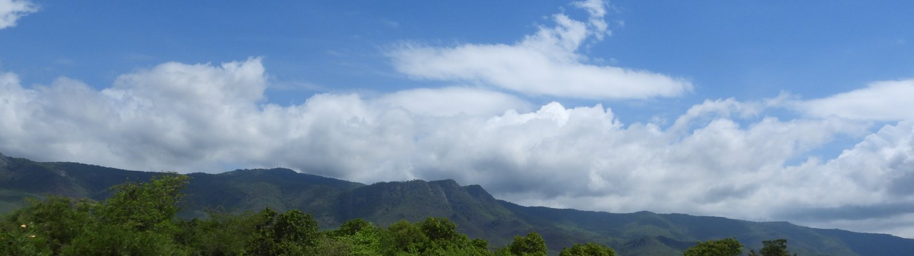

<p align="center"></p>
<p align="center"></p>

<h1 align="center">Bohemian Wind</h1>
<p align="center"><b>From mast data to a permitting pack, in the open.</b><br>
One application for the wind developer's workflow, built for projects in Eastern and Southern Africa.<br>
<i>Clean Energy. Conscious Future.</i></p>

---

> **[COMPLIANCE]** Developer estimates prepared by Bohemian Renewables with open-source tools. Nothing here is an accredited or bankable assessment, and it must not be used for financing decisions. The same notice stays on screen in the application and is printed on every report.

<p align="center"></p>

## What it does

Six steps, in order. Each screen asks for what it needs on the left and shows what it found on the right.

| Step | What you give it | What you get |
|---|---|---|
| 1. **Mast data** | The folder with the logger files | Bad records flagged, wind speed, shear, turbulence, wind rose, a report |
| 2. **Long-term correction** | Nothing (it downloads the reference) | The measured wind scaled to a 20-year average |
| 3. **Wind map** | A height and an area | Mean wind speed over the terrain round the mast |
| 4. **Layout and energy** | Turbine size and number; your exclusion zones, homes and buffers | Turbine positions, wake loss, P50, P75 and P90 |
| 5. **Noise and shadow flicker** | Limits to screen against | Every home checked, with maps |
| 6. **Permitting pack** | Nothing | Coordinates with tip heights, GIS files, maps and a summary page |

<p align="center"></p>

## Where each part stands

Honest status of this version (0.2.0-dev). "Working" means it runs end to end and is covered by tests with known answers; it does not mean validated against measurements.

| Capability | State |
|---|---|
| Daily mast data arriving automatically | **Working as a folder watch.** It re-runs the checks when logger files appear and warns when data stops. It does not fetch from the logger, its email or its cloud service: point those at the folder. |
| Data quality checks and analysis | **Working** for NRG SymphoniePRO, NRG Symphonie text exports (Symphonie Data Retriever), Campbell Scientific TOA5, SecondWind Nomad2 and WindPRO time series exports. RLD files need NRG's free SymPRO Desktop (Windows) to convert them, raw RWD files NRG's free Symphonie Data Retriever. |
| Long-term correction | **Working, one method:** a monthly index against NASA POWER (MERRA-2 at 50 m), with a check of the vane's north against the reanalysis wind direction. No second reference, no hourly method yet. |
| Wind resource maps | **Working, two methods:** the own flow model over SRTM terrain, or the Global Wind Atlas pattern scaled to the mast. |
| Own flow model | **First version.** Terrain speed-up from linear theory (Jackson and Hunt). Tested against theory only, not yet against measured hills or a second mast. Not for steep terrain. |
| Turbine layout with constraints | **Working.** Best cells first with a spacing rule, then wake-aware fine-tuning. It is not a global optimiser. A layout of your own (one point per turbine) can be given instead and is taken as it is. |
| Wake effects and energy yield | **Working,** through [PyWake](https://topfarm.pages.windenergy.dtu.dk/PyWake/) (DTU). Generic turbines by size; no manufacturer curves. |
| Losses and P50/P90 | **Working with default assumptions** that you can edit. The uncertainty budget is a developer's, not an assessor's. |
| Shadow flicker and noise | **Working at screening level:** astronomical worst-case flicker; noise after ISO 9613-2 at one frequency. |
| Your own exclusion zones and buffers | **Working.** GeoJSON, KML, KMZ or CSV; buffers round zones, along lines and from homes; slope and elevation limits. |
| Permitting support | **Working as a pack** of tables, maps and GIS files. It is not legal advice and replaces no study a permit needs. |

Not in it: wind turbine suitability and loads, complex-terrain flow modelling (CFD), electrical design, financial modelling, and anything a lender would call bankable. For those, and for any figure that goes to a financing decision, use an independent accredited assessor.

## Start

**Windows.** Install [Python 3.12](https://www.python.org/downloads/) once (tick *Add python.exe to PATH*). Download this repository (green **Code** button, **Download ZIP**), unzip it, and double-click **`Start Bohemian Wind.bat`**. The first start sets itself up (a few minutes, needs the internet once); after that it opens in your browser in seconds.

**macOS or Linux.** `./start.sh`

**Try it without any data.** On the first screen choose **Open the demo project**, then **Run all six steps**. The demo is an invented site: mast records with five planted faults, a ridge drawn from a formula, homes and exclusion zones. It runs in about ten seconds and needs no internet.

The application runs on your computer only. It opens in your browser, but nothing is uploaded: the only things it downloads are NASA POWER reference data and SRTM terrain tiles for the mast's position.

## Daily intake

Tick **Look in this folder for new logger files** on the *Mast data* screen and Bohemian Wind checks the folder on a timer while it is open. To have it run every morning without opening anything, add one scheduled task (Windows Task Scheduler) that runs:

```
"Start Bohemian Wind.bat" check "C:\path\to\your project"
```

It runs step 1 if new files arrived, records what is new in `intake/status.json`, and exits with code 1 when the newest record is older than the limit you set. More in [docs/daily-intake.md](docs/daily-intake.md).

## For developers

```
pip install -r requirements.txt
python main.py                        # the application
python main.py demo demo-project      # build the demo project and run every step
python main.py run "<project folder>" layout environment pack
python main.py qc "<mast data folder>"   # the data checks alone, as before
python -m pytest tests -q
```

```
bohemian_wind/
  loggers/        TOA5, Nomad2, Symphonie, WindPRO readers  intake/      format detection, one entry point, folder watch
  qc.py analysis.py report.py ...   step 1 engine         climate.py     hand-off from step 1 to the rest
  longterm/       step 2                                  terrain.py     SRTM tiles, local grid, UTM
  flow/           step 3: linear model and wind fields    energy/        step 4: turbines, placement, wakes, losses, P50/P90
  environment/    constraints, noise, sun, flicker        permitting/    step 6: the pack
  maps.py         map pictures                            project.py     a project folder and its six steps
  app/            the local web application               demo.py        the invented demo project
```

How each step works, with its limits: [docs/workflow.md](docs/workflow.md). Design rules: [docs/design.md](docs/design.md).

## How it is tested

- **Known answers.** Exact formulas for shear, turbulence, Weibull and potential flow over ridges; the layout's free-stream energy against PyWake; sun positions against the NREL Solar Position Algorithm (within 0.03°); the local grid against geodesic distances; noise against a hand calculation.
- **Planted faults.** The demo mast and a synthetic SymphoniePRO mast carry gaps, dead cups, stuck vanes, spikes and out-of-range gusts; every one must be found.
- **The whole chain.** The demo project runs through all six steps in the tests, and every turbine must respect every constraint.
- **The interface.** The programming interface is tested for its locks: no token, another site's name or a path outside the project are refused.
- **Real masts, privately.** A private corpus of real masts is re-run on Bohemian's own computers after changes: step 1 against accepted results value by value, steps 2 to 6 against earlier independent calculations where they exist. The data and the results stay there. What those runs break is fixed here with a test built from invented data.

## Your data stays yours

**[COMPLIANCE]** This repository holds code only. Never commit mast data, converted exports, time series, client names, coordinates or reports; `.gitignore` blocks the usual file types as a safety net. Results from client data need the owner's written consent before they are published. Manufacturer power and thrust curves must never be added.

## Licence and credits

Code: MIT (see [LICENSE](LICENSE)). Third-party components and data sources: [THIRD_PARTY_NOTICES.md](THIRD_PARTY_NOTICES.md). The Bohemian Renewables name and logo are not covered by the MIT licence. Photographs: see [docs/images/README.md](docs/images/README.md).

Built by Bohemian Renewables (Africa), Kenya.
