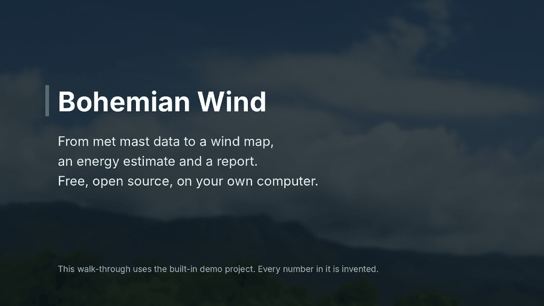
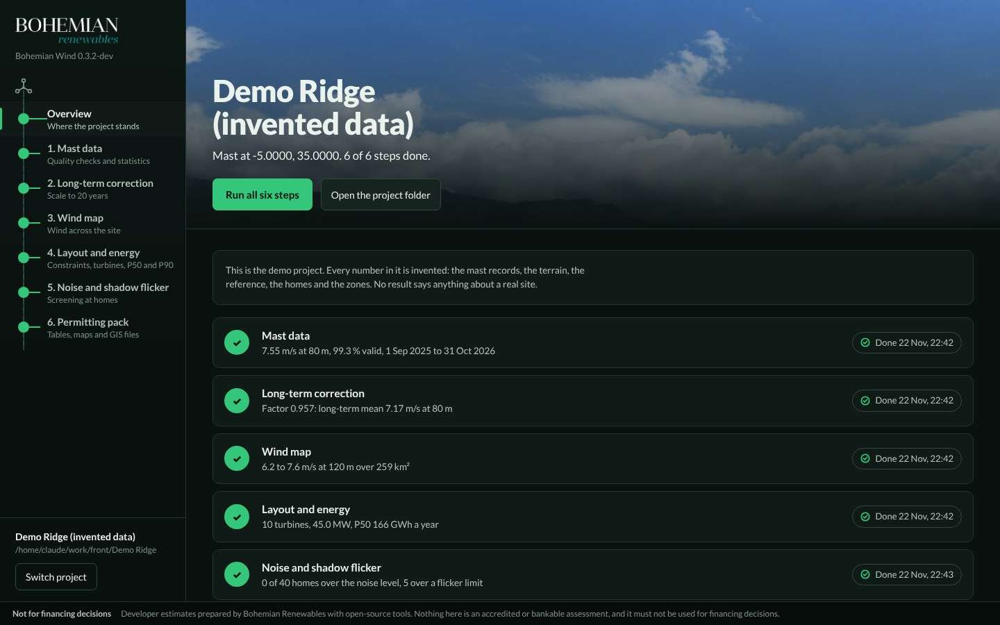
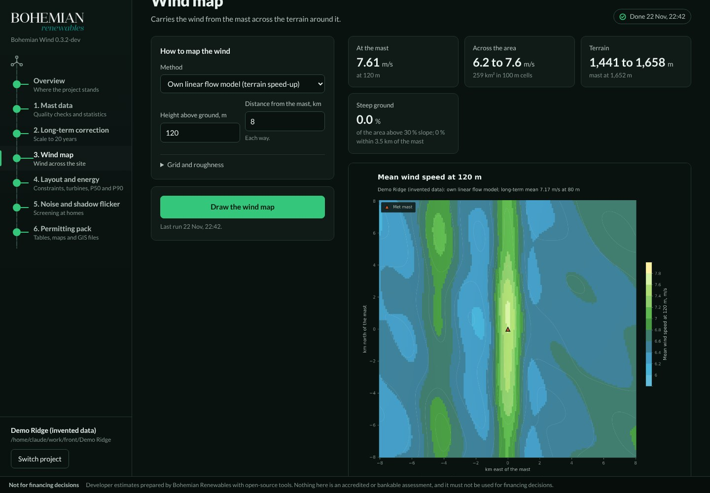
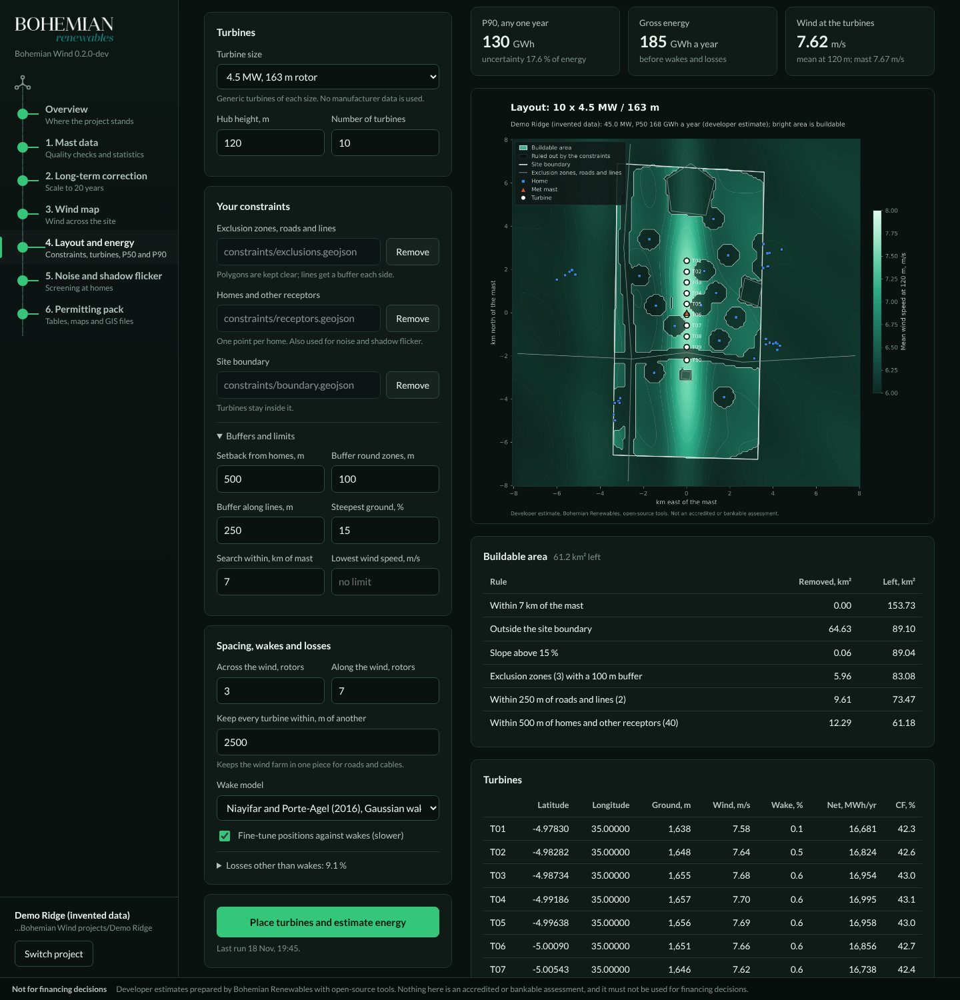

<p align="center"></p>
<p align="center"></p>

<h1 align="center">Bohemian Wind</h1>

<p align="center"><b>From met mast data to a permitting pack, in the open.</b><br>
Open-source software for the wind developer's workflow, built for projects in Eastern and Southern Africa.<br>
<i>Clean Energy. Conscious Future.</i></p>

<p align="center">
  <a href="https://github.com/MugambiD/bohemian-wind/actions/workflows/tests.yml"></a>
  <a href="https://github.com/MugambiD/bohemian-wind/actions/workflows/installer.yml"></a>
  <a href="https://github.com/MugambiD/bohemian-wind/releases"></a>
  <a href="LICENSE"></a>
  
  
</p>

<p align="center">
  <a href="https://github.com/MugambiD/bohemian-wind/releases"></a>
</p>
<p align="center">Free. No account. Runs on your own computer; your measurements never leave it.<br>
<a href="docs/media/bohemian-wind-demo.mp4">Watch the 2-minute demo</a> |
<a href="#try-it-without-any-data">Try it without any data</a> |
<a href="#what-it-does">What it does</a> |
<a href="#where-each-part-stands">Status</a> |
<a href="#documentation">Documentation</a> |
<a href="#for-developers">For developers</a></p>

> [!IMPORTANT]
> **[COMPLIANCE]** Developer estimates prepared by Bohemian Renewables with open-source tools. Nothing here is an accredited or bankable assessment, and it must not be used for financing decisions. The same notice stays on screen in the application and is printed on every report.

## See it in two minutes

<p align="center"><a href="docs/media/bohemian-wind-demo.mp4"></a></p>
<p align="center"><i>The six steps on the built-in demo project (invented data). Select the picture for the <a href="docs/media/bohemian-wind-demo.mp4">full video</a> (MP4, 2 minutes, no sound; if it does not play in the page, download it).</i></p>

| The project at a glance | A classed wind map | A layout with its energy |
|---|---|---|
|  |  |  |
| Six steps, each with its result, marked when out of date | Mean wind speed over the terrain, also as a Google Earth file | Turbines inside your constraints, with P50, P75 and P90 |

## Highlights

- **One application, six steps.** Mast data, long-term correction, wind map, layout and energy, noise and shadow flicker, permitting pack. One project folder, and results that are marked out of date when a setting they rest on changes.
- **Reads what the loggers send.** NRG SymphoniePRO and Symphonie, Campbell Scientific TOA5, SecondWind Nomad2 and WindPRO exports, from the folder or from the ZIP, RAR, 7z or tar archives they arrive in.
- **Three ways to map the wind.** Its own linear flow model, the Global Wind Atlas pattern scaled to the mast, or a CFD screening run with OpenFOAM for steeper ground.
- **Energy with its uncertainty.** Layouts that keep to your exclusion zones and buffers, wake losses through PyWake, and P50, P75 and P90 from an uncertainty budget that follows where each turbine stands.
- **Homes screened.** Buildings from OpenStreetMap and Microsoft's footprints, merged with your own file, each screened for noise and worst-case shadow flicker.
- **Reports and maps you can hand on.** After every step: a wind resource analysis in Word and PDF that shows how far the work has gone, and a Google Earth file. Micrositing and project summary reports follow with the layout.
- **A mast known only from reports.** Monthly summary tables can stand in for logger files for a first view, and every output says so.
- **Private by design.** It runs on your computer, and your measurements never leave it. It goes online only to fetch public reference data for the site's area.

## Download

**Windows 10 or 11 (64-bit).** Download `BohemianWind-<version>-Setup.exe` from [Releases](https://github.com/MugambiD/bohemian-wind/releases) and run it.

- It installs for you alone, without administrator rights, with its own Python, every package and OpenFOAM inside: nothing else to install, and no internet needed.
- Start **Bohemian Wind** from the Start menu. It opens in a window of its own and stops when you close that window.
- Every setup program is built by this repository's build server, and offered only after the server has run every test with what is inside it, installed it, used it and removed it again. Builds of every change to `main` are also kept under *Actions*, *windows installer* (GitHub asks you to sign in to download them).
- It is not signed yet, so Windows asks once whether to run it (*More info*, then *Run anyway*). To check the download, compare `(Get-FileHash .\BohemianWind-<version>-Setup.exe).Hash` in PowerShell with the `.sha256` file published beside it.
- What is inside and how it is built: [docs/windows-installer.md](docs/windows-installer.md).

**From the source.**

- **Windows:** install [Python 3.12](https://www.python.org/downloads/) once (tick *Add python.exe to PATH*). Download this repository (green **Code** button, **Download ZIP**), unzip it, and double-click **`Start Bohemian Wind.bat`**.
- **macOS or Linux:** `./start.sh`
- The first start sets itself up (a few minutes, needs the internet once). After that it opens in your browser in seconds.

### Try it without any data

On the first screen choose **Open the demo project**, then **Run all six steps**. The demo is an invented site: mast records with five planted faults, a ridge drawn from a formula, homes and exclusion zones. It runs in about ten seconds and needs no internet.

## What it does

Six steps, in order. Each screen asks for what it needs on the left and shows what it found on the right.

| Step | What you give it | What you get |
|---|---|---|
| 1. **Mast data** | The folder with the logger files, or with the archives they came in | Bad records flagged, wind speed, shear, turbulence, wind rose, a report |
| 2. **Long-term correction** | Nothing (it downloads the reference) | The measured wind scaled to a 20-year average |
| 3. **Wind map** | A height, an area and a method | Mean wind speed over the terrain round the mast |
| 4. **Layout and energy** | Turbine size and number; your exclusion zones, homes and buffers | Turbine positions, wake loss, P50, P75 and P90 |
| 5. **Noise and shadow flicker** | Limits to screen against | Every home checked, with maps |
| 6. **Permitting pack** | Nothing | Coordinates with tip heights, GIS files, maps, the Google Earth wind map, the three Word reports and a summary page |

### Daily intake

Tick **Look in this folder for new logger files** on the *Mast data* screen and Bohemian Wind checks the folder on a timer while it is open. To have it run every morning without opening anything, add one scheduled task (Windows Task Scheduler) that runs:

```
"Start Bohemian Wind.bat" check "C:\path\to\your project"
```

It runs step 1 if new files arrived, records what is new in `intake/status.json`, and exits with code 1 when the newest record is older than the limit you set. More in [docs/daily-intake.md](docs/daily-intake.md).

## Where each part stands

Honest status of this version (0.3.2-dev). "Working" means it runs end to end and is covered by tests with known answers; it does not mean validated against measurements.

| Capability | State |
|---|---|
| Daily mast data arriving automatically | **Working as a folder watch.** It re-runs the checks when logger files appear and warns when data stops. It does not fetch from the logger, its email or its cloud service: point those at the folder. |
| Data quality checks and analysis | **Working** for NRG SymphoniePRO, NRG Symphonie text exports (Symphonie Data Retriever), Campbell Scientific TOA5, SecondWind Nomad2 and WindPRO time series exports. RLD files need NRG's free SymPRO Desktop (Windows) to convert them, raw RWD files NRG's free Symphonie Data Retriever. ZIP, RAR, 7z and tar archives of logger files are opened as they are; RAR and 7z with the archive program the computer already has. A period when the logger's clock was wrong can be corrected in the project. |
| Long-term correction | **Working, one method:** a monthly index against NASA POWER (MERRA-2 at 50 m), with a check of the vane's north against the reanalysis wind direction. A second reference from a file of your own (for example ERA5 from the Copernicus Climate Data Store) can be set beside it. No hourly method yet. |
| Wind resource maps | **Working, three methods:** the own flow model over SRTM terrain, the Global Wind Atlas pattern scaled to the mast, or CFD with OpenFOAM. |
| Own flow model | **First version.** Terrain speed-up from linear theory (Jackson and Hunt). Tested against theory and, in house, against measured masts: sound on gentle ground, wrong at an escarpment. Not for steep terrain; the application says when the ground is too steep. |
| CFD wind map | **First version.** Steady RANS with OpenFOAM (GPL-3.0, run as separate programs; the Windows setup program carries it with its source). Tested on invented hills and, in house, on measured masts. A screening run, not a flow study for complex terrain. Hours of computing. |
| Turbine layout with constraints | **Working.** Best cells first with a spacing rule, then wake-aware fine-tuning. It is not a global optimiser. A layout of your own (one point per turbine) can be given instead and is taken as it is. |
| Wake effects and energy yield | **Working,** through [PyWake](https://topfarm.pages.windenergy.dtu.dk/PyWake/) (DTU). Generic turbines by size; no manufacturer curves. |
| Losses and P50/P90 | **Working with default assumptions** that you can edit. The uncertainty rules were set against measured masts in house, and they are still a developer's budget, not an assessor's. |
| Shadow flicker and noise | **Working at screening level:** astronomical worst-case flicker; noise after ISO 9613-2 at one frequency. |
| Your own exclusion zones and buffers | **Working.** GeoJSON, KML, KMZ or CSV; buffers round zones, along lines and from homes; slope and elevation limits. |
| Homes | **Working, from open data and your own file.** Buildings from OpenStreetMap and from Microsoft's building footprints are downloaded for the site and merged, and the application says where the two disagree. Your own file of homes (placemarks from Google Earth, for example) goes on top. Every building counts as a home; none of it is a survey. |
| Permitting support | **Working as a pack** of tables, maps and GIS files. It is not legal advice and replaces no study a permit needs. |

**Not in it:** wind turbine suitability and loads, a flow study a lender would accept for complex terrain (the CFD map here is a developer's screening run), electrical design, financial modelling, and anything a lender would call bankable. For those, and for any figure that goes to a financing decision, use an independent accredited assessor.

## Documentation

| Document | Contents |
|---|---|
| [How each step works](docs/workflow.md) | Methods, defaults, uncertainty rules and the limits of every step |
| [Daily intake](docs/daily-intake.md) | The folder watch and the scheduled morning check |
| [Windows setup program](docs/windows-installer.md) | What is inside, how it is built and how it is tested |
| [Design rules and roadmap](docs/design.md) | How the interface is meant to work, and what comes next |
| [Changelog](CHANGELOG.md) | What changed in each version |
| [Third-party notices](THIRD_PARTY_NOTICES.md) | Components and data sources, with their licences |

## For developers

```
pip install -r requirements.txt
python main.py                        # the application
python main.py demo demo-project      # build the demo project and run every step
python main.py run "<project folder>" layout environment pack
python main.py qc "<mast data folder>"   # the data checks alone, for every logger format the application reads
python -m pytest tests -q
```

| Where | What |
|---|---|
| `bohemian_wind/loggers/`, `intake/` | Logger readers (TOA5, Nomad2, Symphonie, WindPRO); format detection, archives, folder watch |
| `bohemian_wind/qc.py`, `analysis.py`, `report.py` | Step 1: checks, statistics, report |
| `bohemian_wind/longterm/` | Step 2: the long-term index |
| `bohemian_wind/terrain.py`, `flow/` | Step 3: SRTM terrain and local grid; linear model, atlas pattern, CFD with OpenFOAM |
| `bohemian_wind/energy/` | Step 4: turbines, placement, wakes, losses, uncertainty, P50/P90 |
| `bohemian_wind/environment/` | Constraints, buildings, noise, shadow flicker |
| `bohemian_wind/permitting/` | Step 6: the pack |
| `bohemian_wind/project.py`, `climate.py`, `maps.py`, `demo.py` | A project folder and its six steps; the hand-off from step 1; map pictures; the invented demo project |
| `bohemian_wind/app/` | The local web application |
| `packaging/` | The Windows setup program, its checks and licence notices; release notes |
| `qc_main.py` | The stand-alone data-check window of earlier versions |

### How it is tested

- **Known answers.** Exact formulas for shear, turbulence, Weibull and potential flow over ridges; the layout's free-stream energy against PyWake; sun positions against the NREL Solar Position Algorithm (within 0.03°); the local grid against geodesic distances; noise against a hand calculation.
- **Planted faults.** The demo mast and a synthetic SymphoniePRO mast carry gaps, dead cups, stuck vanes, spikes and out-of-range gusts; every one must be found.
- **The whole chain.** The demo project runs through all six steps in the tests, and every turbine must respect every constraint.
- **The interface.** The programming interface is tested for its locks: no token, another site's name or a path outside the project are refused.
- **The setup program.** On a Windows build machine every test above is run by the Python, the packages and the OpenFOAM inside the setup program; then the program is installed, the demo project runs through all six steps from the installed copy, the installed start is started, started twice and stopped, and the removal must leave nothing behind.
- **Real masts, privately.** A private corpus of real masts is re-run on Bohemian's own computers after changes: step 1 against accepted results value by value, steps 2 to 6 against earlier independent calculations where they exist. The data and the results stay there. What those runs break is fixed here with a test built from invented data.

## Your data stays yours

The application runs on your computer only. It opens in your browser or its own window, but nothing is uploaded: the only things it downloads are NASA POWER reference data and SRTM terrain tiles for the mast's position and, when you ask for them, the buildings round it from OpenStreetMap and from Microsoft's building footprints.

> [!CAUTION]
> **[COMPLIANCE]** This repository holds code only. Never commit mast data, converted exports, time series, client names, coordinates or reports; `.gitignore` blocks the usual file types as a safety net. Results from client data need the owner's written consent before they are published. Manufacturer power and thrust curves must never be added.

## Contributing

Contributions are welcome. Read [CONTRIBUTING.md](CONTRIBUTING.md) first: every change comes with a test, and no data enters the repository. Please follow the [code of conduct](.github/CODE_OF_CONDUCT.md), and report security problems privately as [SECURITY.md](.github/SECURITY.md) describes, not in a public issue.

## Citing

If Bohemian Wind helps your work, please cite it with the details in [CITATION.cff](CITATION.cff); GitHub's *Cite this repository* button gives them in APA and BibTeX.

## Licence and credits

- **Code:** MIT ([LICENSE](LICENSE)). The Bohemian Renewables name and logo are not covered by the MIT licence. Photographs: see [docs/images/README.md](docs/images/README.md).
- **Built on:** [PyWake](https://topfarm.pages.windenergy.dtu.dk/PyWake/) (DTU Wind Energy, MIT) and [OpenFOAM](https://www.openfoam.com) (OpenCFD Ltd, GPL-3.0, run as separate programs and shipped with its source). OpenFOAM® is a registered trade mark of OpenCFD Ltd; Bohemian Wind is not approved or endorsed by OpenCFD Ltd.
- **Data it uses:** NASA POWER (MERRA-2), SRTM terrain (U.S. Geological Survey), the Global Wind Atlas (DTU, CC BY 4.0; the application scales it to the mast, so the data are changed), OpenStreetMap (© OpenStreetMap contributors, ODbL) and Microsoft's building footprints (CDLA Permissive 2.0).
- **Full notices and attributions:** [THIRD_PARTY_NOTICES.md](THIRD_PARTY_NOTICES.md).

---

<p align="center">Built and maintained by <b>Bohemian Renewables (Africa)</b>, Kenya.<br>Want an analysis run for you, or training for your team? <a href="https://github.com/MugambiD/bohemian-wind/issues">Open an issue</a> to get in touch.</p>
